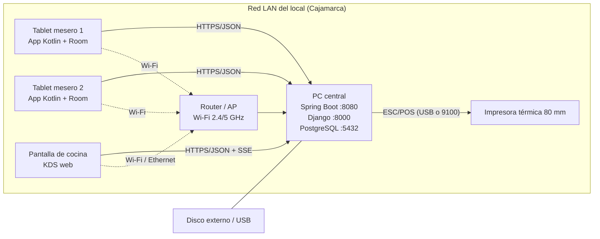
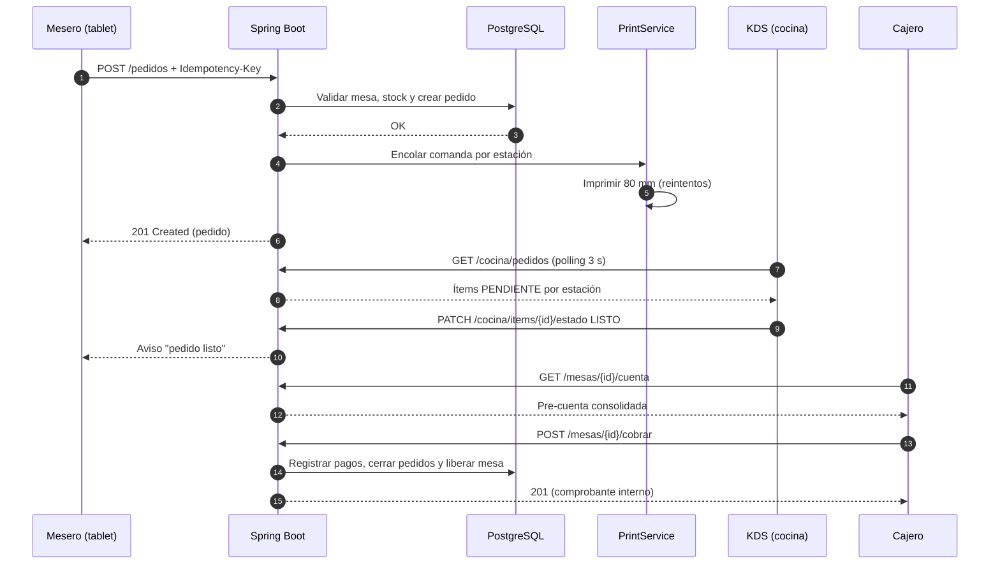
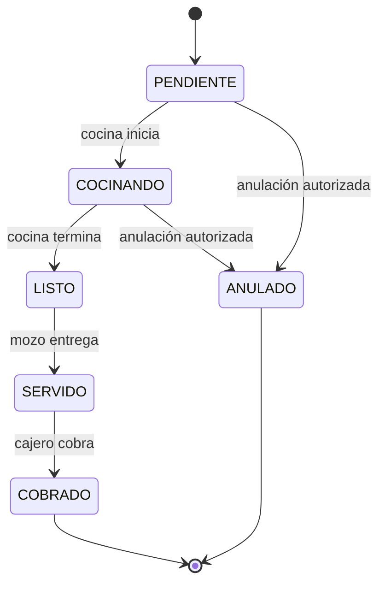
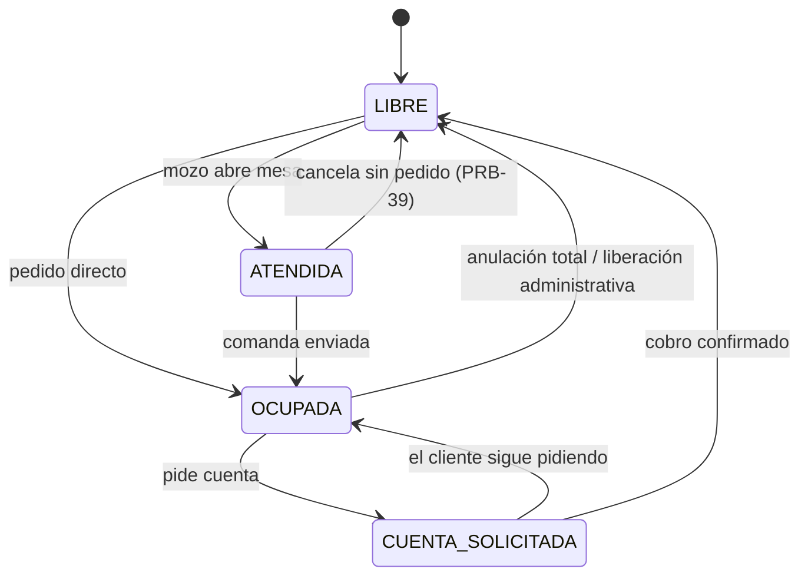

# Plan de Producción POS — Cevichería "La Casa Blanca"

> **Documento de arquitectura y plan de choque.** Revisión: **2026-11-04** (reemplaza la del 02/11).
> **Objetivo:** que el sistema pueda operar un servicio real de 13 mesas en Cajamarca, sin margen de error, con corte de código de producción el **14/11/2026**.
> **Estado:** propuesta para aprobación. No se han creado ni modificado tareas en Jira.
> **Regla:** este documento no sustituye la verificación técnica. Lo que no se ejecutó es **NO VERIFICADO**.
>
> **Base de esta revisión:** `git fetch` + `checkout develop` + `pull` en los 3 repos el 04/11/2026, lectura del código en `develop`, consulta JQL del tablero PRB y contraste con la revisión anterior. Los estados de Jira se citan como tales, **no** como evidencia de entrega.

---

## 1. Veredicto de readiness

**El sistema sigue sin estar listo para producción, pero la base transaccional mejoró.** PRB-40 (máquina de estados + 409) y PRB-23 (calidad estática) ya están en `develop`; eso retira dos bloqueos de la ruta crítica. Siguen faltando cocina, cobro, caja, impresión, inventario, offline y operación: aproximadamente el **55 % del flujo real**.

| Capacidad | Estado al 04/11 | Sustento verificado en `develop` |
|---|---|---|
| Login y mapa de mesas | 🟡 Ámbar | Login, sesión persistente, mapa y polling de 4 s (`MesasViewModel.INTERVALO_POLLING_MS`). PIN solo visual. |
| Apertura y estados de mesa | 🟢 Verde | `MesaService.actualizarEstado` aplica máquina de estados, no-op idempotente y `UPDATE` condicional con 409 (PRB-40). |
| Toma de comanda y envío | 🟡 Ámbar | Catálogo, carrito y `POST /pedidos` existen. Sin idempotencia, consulta de pedidos ni anulación. |
| Cocina / KDS | 🔴 Rojo | No existe pantalla, endpoint ni estados por ítem. |
| Impresión térmica 80 mm | 🔴 Rojo | No existe servicio, formato ni cola de impresión. |
| Pre-cuenta y cobro | 🔴 Rojo | `PRB-43` sigue sin implementar. No hay pagos ni medios de pago. |
| Cierre de caja | 🔴 Rojo | `PRB-47` sigue sin implementar. No hay sesión de caja ni arqueo. |
| Inventario / stock | 🔴 Rojo | `inventario/models.py` solo contiene el comentario de plantilla; `producto.disponible` es un booleano. |
| Modo offline | 🔴 Rojo | `app/build.gradle.kts` no declara Room ni WorkManager; una caída de Wi-Fi pierde la comanda. |
| Idempotencia | 🔴 Rojo | `CrearPedidoRequest` solo tiene `mesa_id` e `items`; no hay clave de idempotencia. Un reintento duplica platos. |
| Reportes | 🔴 Rojo | El panel Django solo gestiona catálogo; no hay ventas, ranking ni medios de pago. |
| Despliegue y backups | 🔴 Rojo | No hay servicios Windows, backups automáticos ni restore probado. |
| Seguridad de producción | 🟡 Ámbar | JWT y BCrypt existen; quedan usuarios de prueba, HTTP claro y autorización incompleta. |
| Calidad y pruebas | 🟡 Ámbar | PRB-23 configurado (JaCoCo/Checkstyle/SpotBugs y Detekt); faltan integración, carga, caos y UAT. |
| Integridad del esquema | 🔴 Rojo | `ddl-auto=validate` con `Mesa` que declara `mozo_id`, `fecha_apertura` y `fecha_cierre`, pero `db/schema.sql` de `develop` no tiene esas columnas. El fix está en la rama `feature/PE-45-dashboard-operativo`, **sin mergear**. |

**Conclusión:** el 14/11 es alcanzable solo con un POS **recortado** y con la ruta crítica sin holgura. La semana del 15 al 21 debe ser de ensayo y estabilización, no de desarrollo. La reasignación de esta revisión libera a Julio del desarrollo para concentrarlo en UAT, capacitación y release, pero traslada presión a Max y Jerardo; el plan se sostiene únicamente si se aplican los recortes de alcance de la sección 8.10.

---

## 2. Qué existe hoy (verificado en el código)

| Módulo | Evidencia revisada (04/11/2026) | Hallazgo |
|---|---|---|
| Backend Java | `PedidoController.java:23-29` | Solo existe `POST /api/v1/pedidos`. No hay `GET`, `PATCH` ni anulación. |
| Backend Java | `PedidoService.java:41-137` | Crea pedido y detalle en una transacción, calcula IGV incluido y delega la mesa a `MesaService.actualizarEstado`. **No usa clave de idempotencia ni descuenta stock.** |
| Backend Java | `MesaService.java:36-91` | Máquina de estados formal, idempotencia de `LIBRE`/`CUENTA_SOLICITADA` y `UPDATE` condicional con 409 (PRB-40, en `develop`). No usa `@Version`. |
| Backend Java | `MesaRepository.java:16-23` | `actualizarEstadoCondicional` y `findEstadoById`: bloqueo optimista a nivel SQL, no JPA. |
| Backend Java | `Pedido.java:11-36` | Sin `client_request_id`, sin `version`, sin `fecha_cierre`, sin subtotal/IGV persistidos. |
| Backend Java | `Producto.java:8-67` | Solo `disponible` booleano; no hay stock numérico ni receta. La estación se deriva del nombre de categoría. |
| Base de datos | `db/schema.sql:3-63` | 6 tablas. Sin pagos, caja, inventario, impresión, auditoría ni idempotencia. **No incluye las columnas de mesa que la entidad ya mapea.** |
| Backoffice Django | `catalogo/urls.py:9-54` | Solo dashboard, CRUD de platos/categorías, pesca del día y carta de ejemplo. |
| Backoffice Django | `inventario/models.py:1` | Módulo vacío (solo comentario de plantilla). |
| Backoffice Django | `catalogo/migrations/0001-0002` | Migraciones propias del catálogo en `develop`. La migración de campos de mesa vive en `feature/PE-45-dashboard-operativo` (`be8c265`), **no mergeada**. |
| App Android | `AndroidManifest.xml:18-35` | 3 Activities: Login, Mesas, Comanda. No hay caja, KDS ni cocina. |
| App Android | `app/build.gradle.kts:45-69` | Sin Room y sin WorkManager. `release` apunta a `https://CAMBIAR-ANTES-DE-RELEASE/`. |
| App Android | `RealPedidoRepository.kt:18-45` | Envía el pedido sin UUID de idempotencia y sin cola persistente. |
| App Android | `MesasViewModel.kt:75-91` | Polling de 4 s idempotente y refresco silencioso (PRB-42, en `develop`). |
| Calidad Java | `pom.xml:103-161` | JaCoCo > 70 %, Checkstyle y SpotBugs configurados (PRB-23, en `develop`). |
| Calidad Android | `app/build.gradle.kts:71-86` y `config/detekt/detekt.yml` | Detekt configurado (PRB-23, en `develop`). |
| Jira | `PRB-1..PRB-48` (consulta JQL 04/11) | PRB-40 y PRB-42 en `TEST`; PRB-23 en `En curso`; PRB-45 y PRB-46 en `En curso`; PRB-21 en `TEST`. Ninguna cubre KDS, impresión, offline, backups ni descuento de stock. |

---

## 3. Comparación con un POS real (flujo completo)

| Etapa | POS real | Sistema actual | Brecha |
|---|---|---|---|
| **1. Apertura** | El mozo abre mesa, asigna comensales y mesero. | `PATCH estado=ATENDIDA` manual. | Falta apertura formal, número de comensales y control de turno. |
| **2. Comanda** | Carta, modificadores, notas, división por estación, envío atómico. | Carta, carrito, notas y estaciones en la respuesta. | Falta idempotencia, anulación, reenvío y control de stock. |
| **3. Cocina** | KDS con columnas por estación, tiempos, priorización y “listo”. | No existe. | Pantalla KDS, endpoints y notificación al mozo. |
| **4. Impresión** | Comanda automática por estación y pre-cuenta en 80 mm. | No existe. | Servicio ESC/POS, formato, cola y reintentos. |
| **5. Pre-cuenta** | Consolidado por mesa, IGV, propina y división. | `PRB-43` sin implementar. | Endpoint, UI y formato impreso. |
| **6. Cobro** | Efectivo, Yape, Plin, tarjeta, mixto, vuelto y propina. | No existe. | Pagos, idempotencia, validación de suma y liberación de mesa. |
| **7. Caja** | Apertura, movimientos, arqueo, diferencia y cierre Z. | No existe. | Sesión de caja, movimientos, cierre y reporte. |
| **8. Administración** | Carta, precios, stock, usuarios, reportes y auditoría. | Catálogo y precios. | Inventario, reportes, usuarios reales y auditoría. |
| **9. Resiliencia** | Offline, reintentos, backups y plan manual. | Sin offline ni backups. | Room, WorkManager, backups y contingencia. |
| **10. Operación** | Capacitación, manual, soporte y rollback. | No existe. | UAT, capacitación, runbook y war room. |

---

## 4. Arquitectura objetivo

### 4.1 Componentes (LAN del local)



**Decisión:** monolito modular en la PC central. No se introducen microservicios ni nube: la latencia objetivo es < 300 ms y la conectividad del local es limitada.

### 4.2 Flujo de una comanda (secuencia)



### 4.3 Estados del pedido



### 4.4 Estados de la mesa



**Regla:** toda transición se valida en el backend con bloqueo optimista (`UPDATE` condicional por estado esperado, ya implementado en PRB-40) y responde **409** si otra tablet cambió el estado. La app nunca decide el estado final por sí sola.

---

## 5. Modelo de datos v2

**Fuente única:** `db/schema.sql` (D7). Spring usa `ddl-auto=validate`; Django usa `managed=False` en tablas compartidas. La migración se aplica antes de desplegar el backend.

### 5.1 Cambios a tablas existentes

```sql
-- pedido: idempotencia, concurrencia, importes y cierre
ALTER TABLE pedido ADD COLUMN client_request_id UUID;
ALTER TABLE pedido ADD COLUMN version BIGINT NOT NULL DEFAULT 0;
ALTER TABLE pedido ADD COLUMN subtotal NUMERIC(10,2) NOT NULL DEFAULT 0;
ALTER TABLE pedido ADD COLUMN igv NUMERIC(10,2) NOT NULL DEFAULT 0;
ALTER TABLE pedido ADD COLUMN descuento NUMERIC(10,2) NOT NULL DEFAULT 0;
ALTER TABLE pedido ADD COLUMN propina NUMERIC(10,2) NOT NULL DEFAULT 0;
ALTER TABLE pedido ADD COLUMN fecha_actualizacion TIMESTAMP;
ALTER TABLE pedido ADD COLUMN fecha_cierre TIMESTAMP;
ALTER TABLE pedido DROP CONSTRAINT pedido_estado_check;
ALTER TABLE pedido ADD CONSTRAINT pedido_estado_check
    CHECK (estado IN ('PENDIENTE','COCINANDO','LISTO','SERVIDO','COBRADO','ANULADO'));
CREATE UNIQUE INDEX ux_pedido_client_request
    ON pedido(client_request_id) WHERE client_request_id IS NOT NULL;
CREATE INDEX idx_pedido_fecha_estado ON pedido(fecha_creacion, estado);

-- detalle_pedido: estado por ítem y estación
ALTER TABLE detalle_pedido ADD COLUMN estado_item VARCHAR(20) NOT NULL DEFAULT 'PENDIENTE'
    CHECK (estado_item IN ('PENDIENTE','EN_PREPARACION','LISTO','SERVIDO','ANULADO'));
ALTER TABLE detalle_pedido ADD COLUMN estacion VARCHAR(30) NOT NULL DEFAULT 'COCINA_CALIENTE';
ALTER TABLE detalle_pedido ADD COLUMN anulado_motivo VARCHAR(255);
CREATE INDEX idx_detalle_estado_estacion ON detalle_pedido(estado_item, estacion);

-- mesa: mozo responsable y marcas de apertura/cierre (ya mapeadas por Mesa.java)
ALTER TABLE mesa ADD COLUMN mozo_id INT REFERENCES usuario(id) ON DELETE SET NULL;
ALTER TABLE mesa ADD COLUMN fecha_apertura TIMESTAMP;
ALTER TABLE mesa ADD COLUMN fecha_cierre TIMESTAMP;
CREATE INDEX idx_fk_mesa_mozo ON mesa(mozo_id);

-- usuario: PIN y control de acceso
ALTER TABLE usuario ADD COLUMN pin_hash VARCHAR(255);
ALTER TABLE usuario ADD COLUMN activo BOOLEAN NOT NULL DEFAULT TRUE;
ALTER TABLE usuario ADD COLUMN ultimo_acceso TIMESTAMP;

-- producto: stock directo para platos sin receta
ALTER TABLE producto ADD COLUMN stock_disponible INT;
ALTER TABLE producto ADD COLUMN stock_minimo INT NOT NULL DEFAULT 0;
```

### 5.2 Tablas nuevas

```sql
-- caja_sesion se crea antes que pago por la FK caja_sesion_id
CREATE TABLE caja_sesion (
    id SERIAL PRIMARY KEY,
    usuario_apertura_id INT NOT NULL REFERENCES usuario(id) ON DELETE RESTRICT,
    usuario_cierre_id INT REFERENCES usuario(id) ON DELETE RESTRICT,
    fecha_apertura TIMESTAMP NOT NULL DEFAULT CURRENT_TIMESTAMP,
    fecha_cierre TIMESTAMP,
    monto_inicial NUMERIC(10,2) NOT NULL DEFAULT 0,
    monto_esperado NUMERIC(10,2),
    monto_contado NUMERIC(10,2),
    diferencia NUMERIC(10,2),
    estado VARCHAR(20) NOT NULL DEFAULT 'ABIERTA'
        CHECK (estado IN ('ABIERTA','CERRADA')),
    observacion TEXT
);
CREATE UNIQUE INDEX ux_caja_abierta ON caja_sesion(estado)
    WHERE estado = 'ABIERTA';

CREATE TABLE pago (
    id SERIAL PRIMARY KEY,
    pedido_id INT NOT NULL REFERENCES pedido(id) ON DELETE RESTRICT,
    caja_sesion_id INT REFERENCES caja_sesion(id) ON DELETE RESTRICT,
    metodo VARCHAR(20) NOT NULL
        CHECK (metodo IN ('EFECTIVO','YAPE','PLIN','TARJETA','TRANSFERENCIA')),
    monto NUMERIC(10,2) NOT NULL CHECK (monto > 0),
    propina NUMERIC(10,2) NOT NULL DEFAULT 0,
    referencia VARCHAR(100),
    client_request_id UUID NOT NULL UNIQUE,
    usuario_id INT NOT NULL REFERENCES usuario(id) ON DELETE RESTRICT,
    fecha TIMESTAMP NOT NULL DEFAULT CURRENT_TIMESTAMP
);
CREATE INDEX idx_pago_caja ON pago(caja_sesion_id);
CREATE INDEX idx_pago_fecha ON pago(fecha);

CREATE TABLE movimiento_caja (
    id SERIAL PRIMARY KEY,
    caja_sesion_id INT NOT NULL REFERENCES caja_sesion(id) ON DELETE RESTRICT,
    tipo VARCHAR(20) NOT NULL
        CHECK (tipo IN ('INGRESO','EGRESO','VENTA','DEVOLUCION')),
    concepto VARCHAR(150) NOT NULL,
    monto NUMERIC(10,2) NOT NULL,
    referencia VARCHAR(100),
    usuario_id INT NOT NULL REFERENCES usuario(id) ON DELETE RESTRICT,
    fecha TIMESTAMP NOT NULL DEFAULT CURRENT_TIMESTAMP
);
CREATE INDEX idx_mov_caja ON movimiento_caja(caja_sesion_id, fecha);

CREATE TABLE insumo (
    id SERIAL PRIMARY KEY,
    nombre VARCHAR(150) NOT NULL UNIQUE,
    unidad_medida VARCHAR(20) NOT NULL,
    stock_actual NUMERIC(12,3) NOT NULL DEFAULT 0,
    stock_minimo NUMERIC(12,3) NOT NULL DEFAULT 0,
    costo_unitario NUMERIC(10,2) NOT NULL DEFAULT 0,
    activo BOOLEAN NOT NULL DEFAULT TRUE
);

CREATE TABLE receta (
    id SERIAL PRIMARY KEY,
    producto_id INT NOT NULL REFERENCES producto(id) ON DELETE CASCADE,
    insumo_id INT NOT NULL REFERENCES insumo(id) ON DELETE RESTRICT,
    cantidad NUMERIC(12,3) NOT NULL CHECK (cantidad > 0),
    UNIQUE (producto_id, insumo_id)
);

CREATE TABLE movimiento_stock (
    id SERIAL PRIMARY KEY,
    insumo_id INT NOT NULL REFERENCES insumo(id) ON DELETE RESTRICT,
    tipo VARCHAR(20) NOT NULL
        CHECK (tipo IN ('ENTRADA','SALIDA_VENTA','AJUSTE','MERMA','DEVOLUCION')),
    cantidad NUMERIC(12,3) NOT NULL,
    stock_resultante NUMERIC(12,3) NOT NULL,
    referencia VARCHAR(100),
    usuario_id INT NOT NULL REFERENCES usuario(id) ON DELETE RESTRICT,
    fecha TIMESTAMP NOT NULL DEFAULT CURRENT_TIMESTAMP
);
CREATE INDEX idx_mov_stock ON movimiento_stock(insumo_id, fecha);

CREATE TABLE impresion_cola (
    id SERIAL PRIMARY KEY,
    pedido_id INT REFERENCES pedido(id) ON DELETE CASCADE,
    tipo VARCHAR(20) NOT NULL CHECK (tipo IN ('COMANDA','PRECUENTA')),
    estacion VARCHAR(30),
    payload TEXT NOT NULL,
    estado VARCHAR(20) NOT NULL DEFAULT 'PENDIENTE'
        CHECK (estado IN ('PENDIENTE','IMPRESO','FALLIDO')),
    intentos INT NOT NULL DEFAULT 0,
    error TEXT,
    fecha_creacion TIMESTAMP NOT NULL DEFAULT CURRENT_TIMESTAMP,
    fecha_impresion TIMESTAMP
);
CREATE INDEX idx_impresion_pendiente ON impresion_cola(estado, fecha_creacion);

CREATE TABLE evento_pedido (
    id SERIAL PRIMARY KEY,
    pedido_id INT NOT NULL REFERENCES pedido(id) ON DELETE CASCADE,
    estado_anterior VARCHAR(20),
    estado_nuevo VARCHAR(20) NOT NULL,
    usuario_id INT REFERENCES usuario(id) ON DELETE SET NULL,
    motivo VARCHAR(255),
    fecha TIMESTAMP NOT NULL DEFAULT CURRENT_TIMESTAMP
);
CREATE INDEX idx_evento_pedido ON evento_pedido(pedido_id, fecha);

CREATE TABLE configuracion (
    clave VARCHAR(50) PRIMARY KEY,
    valor VARCHAR(255) NOT NULL,
    descripcion VARCHAR(255)
);
```

### 5.3 Índices y reglas de integridad

- `pedido.client_request_id` único: garantiza idempotencia a nivel de base de datos.
- `pago.client_request_id` único: evita cobrar dos veces el mismo pago.
- `caja_sesion` con índice único parcial: solo puede haber una caja abierta.
- `receta(producto_id, insumo_id)` único: evita duplicar componentes.
- `movimiento_stock.stock_resultante`: trazabilidad completa del inventario.
- `evento_pedido`: auditoría inmutable de transiciones y anulaciones.

### 5.4 Estrategia de migración

1. **04/11 20:00** — backup completo (`pg_dump -Fc`).
2. **05/11** — mergear `feature/PE-45-dashboard-operativo` (commit `be8c265`) o portar solo el `ALTER TABLE mesa` a `develop`. Sin esto, `ddl-auto=validate` falla contra el `schema.sql` de `develop`: la entidad `Mesa` declara `mozo_id`, `fecha_apertura` y `fecha_cierre` que el DDL no tiene.
3. Crear `db/migrations/V2__produccion.sql` con los cambios de 5.1 y 5.2 y aplicarlo en una base de staging.
4. Ejecutar `mvn test` y `pytest` contra staging.
5. Aplicar en producción local con el backend detenido.
6. Verificar `ddl-auto=validate` y arrancar servicios.
7. **Rollback:** restaurar el dump y desplegar el jar anterior. Ensayo obligatorio el **12/11**, no el mismo día del corte.

> **Nota sobre Django:** las migraciones del catálogo (`0001_initial`, `0002_producto_categoria`) son las únicas que Django administra. Las tablas compartidas deben declararse con `managed = False`; Django no crea ni altera tablas no gestionadas (confirmado en la documentación de Django, `Options.can_migrate`). El DDL de producción sigue siendo responsabilidad de `db/schema.sql` + `V2__produccion.sql`.

---

## 6. Contratos REST v2

Base: `http://<IP-LAN-PC>:8080/api/v1`. Header `Authorization: Bearer <jwt>` salvo login y health. JSON `snake_case`. Errores: `{"mensaje":"...","codigo":"...","detalles":[...]}`.

### 6.1 Autenticación y acceso

| Método | Ruta | Request | Response | Errores | Roles |
|---|---|---|---|---|---|
| POST | `/auth/login` | `{usuario, clave}` | `{token, tipo, usuario:{id,nombre,rol}}` | 401, 403 | Público |
| POST | `/auth/pin` | `{usuario, pin}` | Igual que login | 401, 423 (bloqueado) | Público |
| GET | `/auth/me` | — | Usuario | 401 | Todos |
| POST | `/auth/logout` | — | 204 | 401 | Todos |

**Reglas:** PIN de 4 dígitos con hash BCrypt; 5 intentos fallidos bloquean 15 minutos; JWT de 12 h (turno); el token se guarda cifrado en la tablet.

### 6.2 Pedidos

| Método | Ruta | Request | Response | Errores | Roles |
|---|---|---|---|---|---|
| POST | `/pedidos` | `{mesa_id, items:[{producto_id,cantidad,notas}], client_request_id}` + header `Idempotency-Key` | 201 pedido; 200 si es replay | 400, 401, 403, 404, 409, 422 | MOZO, ADMIN |
| GET | `/pedidos?mesa_id=&estado=&desde=&hasta=` | — | Lista | 401 | MOZO, CAJERO, ADMIN |
| GET | `/pedidos/{id}` | — | Pedido con detalle | 404 | MOZO, CAJERO, ADMIN |
| PATCH | `/pedidos/{id}/estado` | `{estado, motivo}` | Pedido | 400, 409 | COCINERO, CAJERO, ADMIN |
| POST | `/pedidos/{id}/anular` | `{motivo}` | Pedido anulado | 409 (ya cobrado) | MOZO, ADMIN |
| POST | `/pedidos/{id}/items/{itemId}/anular` | `{motivo}` | Pedido | 409 | MOZO, ADMIN |

**Idempotencia:** `client_request_id` UUID v4 generado en la app. Si llega un UUID existente, el backend devuelve **200** con el mismo cuerpo y `replay: true`; no vuelve a descontar stock ni a imprimir. Si falta la clave, se acepta por compatibilidad pero se registra una advertencia; la app siempre la envía.

**Stock:** si un insumo no alcanza, **422** `{"codigo":"STOCK_INSUFICIENTE","detalles":[...]}`. El pedido no se crea (rollback total).

### 6.3 Cocina (KDS)

| Método | Ruta | Request | Response | Errores | Roles |
|---|---|---|---|---|---|
| GET | `/cocina/pedidos?estacion=&estado=` | — | Ítems con `tiempo_transcurrido_seg` y `sla_seg` | 401 | COCINERO, ADMIN |
| PATCH | `/cocina/items/{id}/estado` | `{estado}` | Ítem | 400, 409 | COCINERO, ADMIN |
| GET | `/cocina/eventos` | — | SSE de nuevos pedidos y cambios | 401 | COCINERO, ADMIN |

**SLA:** 10 min verde, 15 min ámbar, > 15 min rojo. Configurable en `configuracion`.

### 6.4 Pre-cuenta y cobro

| Método | Ruta | Request | Response | Errores | Roles |
|---|---|---|---|---|---|
| GET | `/mesas/{id}/cuenta` | — | `{pedidos, items, subtotal, igv, total, propina_sugerida}` | 404 | MOZO, CAJERO, ADMIN |
| POST | `/mesas/{id}/precuenta` | `{imprimir:true}` | 201 con número y estado de impresión | 409 (mesa libre) | MOZO, CAJERO |
| POST | `/mesas/{id}/cobrar` | `{pagos:[{metodo,monto,referencia}], propina, observacion, client_request_id}` | 201 `{total, pagado, vuelto, pedidos}` | 400, 409, 422 | CAJERO, ADMIN |
| POST | `/pedidos/{id}/pagos` | Pago parcial | 201 | 400, 409 | CAJERO, ADMIN |

**Reglas:**
- La suma de pagos debe ser **exactamente** `total + propina`. Si falta o sobra, **422**.
- Efectivo: se calcula `vuelto`. Yape/Plin/Tarjeta: se exige `referencia` (número de operación).
- El cobro es idempotente por `client_request_id`.
- Al cobrar: pedidos → `COBRADO`, mesa → `LIBRE`, se registra el movimiento de caja.
- **Tarjeta:** registro manual del voucher; no hay pasarela en v1.

### 6.5 Caja

| Método | Ruta | Request | Response | Errores | Roles |
|---|---|---|---|---|---|
| POST | `/caja/sesiones` | `{monto_inicial}` | 201 sesión | 409 (ya abierta) | CAJERO, ADMIN |
| GET | `/caja/sesiones/actual` | — | Sesión + resumen | 404 | CAJERO, ADMIN |
| POST | `/caja/sesiones/{id}/cerrar` | `{monto_contado, observacion}` | 200 con `diferencia` | 409 | CAJERO, ADMIN |
| GET | `/caja/sesiones/{id}/resumen` | — | Ventas por método, egresos, esperado | 404 | CAJERO, ADMIN |

### 6.6 Reportes

| Método | Ruta | Request | Response | Roles |
|---|---|---|---|---|
| GET | `/reportes/ventas?desde=&hasta=&turno=` | — | Totales, ticket promedio, por método | ADMIN, CAJERO |
| GET | `/reportes/ranking?desde=&hasta=&limite=10` | — | Platos más vendidos | ADMIN |
| GET | `/reportes/medios-pago?fecha=` | — | Desglose por método | ADMIN, CAJERO |
| GET | `/reportes/export.csv?tipo=ventas&desde=&hasta=` | — | CSV | ADMIN |

### 6.7 Inventario

| Método | Ruta | Request | Response | Roles |
|---|---|---|---|---|
| GET | `/inventario/insumos` | — | Lista con stock y alerta | ADMIN |
| POST | `/inventario/insumos` | `{nombre, unidad_medida, stock_minimo, costo_unitario}` | 201 | ADMIN |
| PATCH | `/inventario/insumos/{id}` | Campos editables | 200 | ADMIN |
| POST | `/inventario/ajustes` | `{insumo_id, tipo, cantidad, motivo}` | 201 | ADMIN |
| GET | `/inventario/alertas` | — | Insumos bajo mínimo | ADMIN |
| GET | `/inventario/recetas/{productoId}` | — | Receta | ADMIN |
| PUT | `/inventario/recetas/{productoId}` | `[{insumo_id, cantidad}]` | 200 | ADMIN |

### 6.8 Operación

| Método | Ruta | Response | Auth |
|---|---|---|---|
| GET | `/health` | `{status, db, version, uptime_seg}` | Público en LAN |
| GET | `/actuator/health` | Estado detallado | ADMIN |
| GET | `/version` | Commit y fecha de build | Público en LAN |

---

## 7. Estructura de carpetas propuesta

### 7.1 Backend Java (Layered + módulos por feature)

```
restaurante-backend-java/
├─ src/main/java/com/lacasablanca/backend/
│  ├─ auth/            # login, PIN, JWT, roles
│  ├─ mesa/            # máquina de estados y bloqueo optimista
│  ├─ pedido/          # comanda, idempotencia, anulación
│  ├─ cocina/          # KDS y estados por ítem
│  ├─ caja/            # sesión, pagos, arqueo
│  ├─ inventario/      # insumos, recetas, stock
│  ├─ impresion/       # ESC/POS, cola y reintentos
│  ├─ reporte/         # consultas y export CSV
│  ├─ config/          # seguridad, Jackson, OpenAPI
│  ├─ common/          # errores, auditoría, utilidades
│  └─ BackendApplication.java
├─ src/main/resources/
│  ├─ application.yml
│  ├─ application-prod.yml
│  └─ db/migration/    # solo lectura; el DDL vive en admin-django
└─ src/test/java/...   # integración, idempotencia, concurrencia
```

### 7.2 Backoffice Django

```
restaurante-admin-django/
├─ catalogo/           # carta, precios, pesca del día (existente)
├─ inventario/         # insumos, recetas, stock, merma
├─ operacion/          # KDS web (cocina/barra) y estados
├─ caja/               # apertura, movimientos, cierre Z
├─ reportes/           # ventas, ranking, medios de pago, CSV
├─ impresion/          # plantillas 80 mm y reimpresión
├─ core/               # autenticación, permisos, auditoría
├─ db/
│  ├─ schema.sql       # fuente única del DDL
│  ├─ seed.sql
│  └─ migrations/V2__produccion.sql
└─ config/
```

### 7.3 App Android (MVVM + repositorio)

```
restaurante-app-kotlin/
├─ app/src/main/java/com/lacasablanca/mesero/
│  ├─ data/
│  │  ├─ local/
│  │  │  ├─ db/          # Room: entidades, DAO, AppDatabase
│  │  │  ├─ outbox/      # cola persistente de comandas
│  │  │  └─ session/     # token cifrado (existente)
│  │  ├─ remote/         # Retrofit (existente)
│  │  ├─ repository/     # repositorios reales y fake
│  │  └─ sync/           # SyncWorker, mapeadores
│  ├─ domain/            # modelos y casos de uso
│  ├─ ui/
│  │  ├─ login/          # credenciales + PIN
│  │  ├─ mesas/          # mapa y polling
│  │  ├─ comanda/        # catálogo y carrito
│  │  ├─ caja/           # pre-cuenta, cobro y cierre
│  │  └─ common/         # componentes y formato
│  ├─ work/              # WorkManager: reintentos y sincronización
│  └─ MeseroApp.kt
└─ app/src/test/...      # 71 pruebas actuales + nuevas de offline
```

---

## 8. Plan de tareas para producción

### 8.1 Reglas del plan

- **Corte de código:** 14/11/2026. Nada de desarrollo funcional después.
- **Semana 15–21/11:** ensayo, correcciones críticas y capacitación; no features.
- **Apertura real:** 22/11/2026 (día siguiente a la exposición).
- **Prioridad:** `Highest` = bloquea el flujo de dinero o la comanda; `High` = necesario para operar; `Medium` = mejora operativa.
- **Capacidad:** 4 personas × 10 días (04–14/11) = **40 persona-día**. El alcance se recortó a ~36 persona-día; no hay colchón. Cualquier tarea nueva desplaza a otra.
- **Reasignación vigente (04/11/2026):** Julio sale del desarrollo y queda en UAT, capacitación y release. Max absorbe despliegue, backups, hardware y pruebas de carga/caos. Jerardo absorbe impresión. David mantiene cobro UI, offline y E2E.

### 8.2 Fase 0 — Cierre de base (04–06/11)

| ID | Tarea | Asignado | Prioridad | Vence | Jira | Depende de |
|---|---|---|---|---|---|---|
| P-01 | Congelar alcance de producción, DoD y contrato API v2 (OpenAPI) | Max | Highest | **04/11 (este documento lo formaliza; pendiente de aprobación)** | Nueva | — |
| P-02 | Validar hardware, red LAN, UPS e impresora; plan de contingencia física | **Max** | Highest | **05/11** | Nueva | — |
| P-03 | Esquema BD v2, migración `V2__produccion.sql` y seeds; incluye mergear `be8c265` (campos de mesa) | Jerardo | Highest | **05/11** | Extiende PRB-8 | P-01 |
| P-04 | Migración de datos reales: carta, precios, fotos, 13 mesas, usuarios y PIN | Jerardo | Highest | **06/11** | Nueva | P-03 |

### 8.3 Fase 1 — Núcleo transaccional (05–10/11)

| ID | Tarea | Asignado | Prioridad | Vence | Jira | Depende de |
|---|---|---|---|---|---|---|
| P-05 | Máquina de estados de mesa, bloqueo optimista y 409 | Max | Highest | **04/11 (HECHA en `develop`)** | PRB-40 (existe) | — |
| P-06 | Idempotencia real, consulta, anulación y auditoría de pedidos | Max | Highest | **07/11** | Nueva | P-05 |
| P-07 | Roles, PIN de 4 dígitos, bloqueo por intentos y endurecimiento de acceso | Max | Highest | **09/11** | Absorbe PRB-12 | P-06 |
| P-08 | Pre-cuenta, división de cuenta y cobro multi-medio (backend) | **Max** | Highest | **08/11** | Amplía PRB-43 | P-06 |
| P-09 | UI de caja/cobro en tablet: pre-cuenta, medios de pago y vuelto | David | Highest | **10/11** | Nueva | P-08 |

### 8.4 Fase 2 — Cocina e impresión (06–10/11)

| ID | Tarea | Asignado | Prioridad | Vence | Jira | Depende de |
|---|---|---|---|---|---|---|
| P-10 | KDS web: estaciones, estados, tiempos, SLA y aviso al mozo | Jerardo | Highest | **08/11** | Nueva | P-03 |
| P-11 | Impresión térmica 80 mm: formatos, cola, reintentos y reimpresión | **Jerardo** | Highest | **10/11** | Nueva | P-02, P-10 |
| P-12 | Notificación de "pedido listo" en la app del mesero | — | High | **10/11 (RECORTADA)** | Nueva | P-10 |

### 8.5 Fase 3 — Inventario, caja y reportes (07–13/11)

| ID | Tarea | Asignado | Prioridad | Vence | Jira | Depende de |
|---|---|---|---|---|---|---|
| P-13 | Inventario **reducido**: stock del día por producto, descuento y reversión; sin recetas/insumos ni merma | Jerardo | Highest | **12/11** | Nueva | P-03 |
| P-14 | Cierre de caja: apertura, arqueo, diferencia y cierre Z | Jerardo | Highest | **11/11** | Amplía PRB-47 | P-08 |
| P-15 | Reportes **básicos**: ventas del día y medios de pago; ranking y CSV quedan post-lanzamiento | Jerardo | High | **13/11** | Amplía PRB-45 | P-14 |

### 8.6 Fase 4 — Offline y resiliencia (05–13/11)

| ID | Tarea | Asignado | Prioridad | Vence | Jira | Depende de |
|---|---|---|---|---|---|---|
| P-16 | Room: caché de carta/mesas y outbox persistente de comandas | David | Highest | **08/11** | Nueva | P-06 |
| P-17 | WorkManager: sync, reintentos, conflictos e indicador de conexión | David | Highest | **11/11** | Nueva | P-16 |
| P-18 | Healthchecks y logs rotativos **solamente**; métricas y alertas quedan post-lanzamiento | Max | High | **13/11** | Nueva | P-03 |

### 8.7 Fase 5 — Infraestructura y go-live (09–14/11)

| ID | Tarea | Asignado | Prioridad | Vence | Jira | Depende de |
|---|---|---|---|---|---|---|
| P-19 | Despliegue en la PC: PostgreSQL, backend y Django como servicios Windows | **Max** | Highest | **11/11** | Amplía PRB-48 | P-03 |
| P-20 | Backups automáticos de BD e imágenes + restore probado | **Max** | Highest | **12/11** | Nueva | P-19 |
| P-21 | Hardening de seguridad y auditoría final de código | Max | Highest | **12/11** | Nueva | P-07 |
| P-22 | Pruebas de carga (latencia < 300 ms) y caos Wi-Fi/luz/impresora | **Max** | High | **13/11** | Amplía PRB-24/25 | P-19 |
| P-23 | E2E en tablet física contra backend real | David | Highest | **12/11** | PRB-46 (existe) | P-17 |
| P-24 | UAT con el dueño y un mozo real + correcciones | **Julio** | Highest | **13/11** | Amplía PRB-26 | P-23 |
| P-25 | Capacitación, manual operativo y plan de contingencia en papel | **Julio** | High | **13/11** | Nueva | P-24 |
| P-26 | Release de producción, APK firmado, tag, rollback y war room | **Julio + Max** | Highest | **14/11** | Reemplaza PRB-48 | P-24 |

### 8.8 Tareas existentes que deben re-planificarse (no duplicar)

| Key | Tarea | Asignado actual | Nueva fecha | Acción |
|---|---|---|---|---|
| PRB-12 | Usuarios y roles del panel | Julio | 09/11 | **Absorbida por P-07 (Max)**; reasignar o cerrar. |
| PRB-21 | Pruebas de integración backend | Max | 07/11 | Rama `feature/PRB-21-pruebas-integracion-mockmvc` ya existe; cubre idempotencia y 409. |
| PRB-22 | Pipeline CI con GitHub Actions | Julio | 06/11 | Se mantiene en Julio; es la única tarea técnica que conserva. |
| PRB-23 | Calidad estática | Jerardo | **04/11 (HECHA en código)** | JaCoCo/Checkstyle/SpotBugs y Detekt en `develop`; cerrar en Jira tras verificar el build. |
| PRB-24 | Criterios de rendimiento | Julio | 09/11 | Se integra en P-22 (Max). |
| PRB-25 | Pruebas de carga | Jerardo | 12/11 | Se integra en P-22 (Max); la rama `feature/PE-25-pruebas-carga-locust` ya existe. |
| PRB-26 | UAT y E2E | David | 13/11 | **Absorbida por P-24 (Julio)**; se ejecuta una sola vez. |
| PRB-40 | Máquina de estados + 409 | Max | **04/11 (HECHA en `develop`)** | Cerrar en Jira tras verificar el build; ya no consume capacidad. |
| PRB-42 | Polling entre tablets | David | **02/11 (HECHA en `develop`)** | Cerrar en Jira; el polling de 4 s está implementado. |
| PRB-43 | Pre-cuenta con IGV y medios de pago | Julio | 08/11 | Ampliada por P-08 (Max); reasignar a Max. |
| PRB-45 | Dashboard operativo | Jerardo | 11/11 | Ampliado por P-14/P-15; el código está en `feature/PE-45`, sin mergear. |
| PRB-46 | E2E manual en tablet | David | 12/11 | **Absorbida por P-23**; se ejecuta una sola vez. |
| PRB-47 | Reportes por turno y cierre | Jerardo | 11/11 | Ampliado por P-14/P-15. |
| PRB-48 | Release v0.1.0 | Julio | 14/11 | Reemplazado por P-26 (release de producción, Julio + Max). |

### 8.9 Ruta crítica y capacidad

```
P-03 → P-04
P-03 → P-05 (HECHA) → P-06 → P-08 → P-09
P-06 → P-07
P-03 → P-10 → P-11
P-08 → P-14 → P-15
P-03 → P-13
P-06 → P-16 → P-17 → P-23 → P-24 → P-25 → P-26
P-03 → P-19 → P-20
P-19 → P-22
P-07 → P-21
```

**Ruta crítica real:** `P-03 → P-06 → P-08 → P-09 → P-14 → P-24 → P-26`. Si se retrasa P-03 (esquema), P-06 (idempotencia) o P-08 (cobro), se retrasa el lanzamiento. No admiten recorte.

**Carga por persona (10 días):**

| Persona | Tareas vivas | Días estimados | Riesgo |
|---|---|---|---|
| Max | P-02, P-06, P-07, P-08, P-18, P-19, P-20, P-21, P-22, P-26 | 11–12 | **Alto**: dos pares de tareas caen el mismo día (12/11 y 13/11). |
| Jerardo | P-03, P-04, P-10, P-11, P-13, P-14, P-15 | 10–11 | **Alto**: P-03/P-04 bloquean a todos; no tiene holgura. |
| David | P-09, P-16, P-17, P-23 | 8–9 | Medio: P-09 y P-17 se solapan el 10–11/11. |
| Julio | PRB-22 (CI), P-24, P-25, P-26 | 4–5 | Bajo en desarrollo; alta responsabilidad en el cierre. |

**Capacidad estimada:** ~36 persona-día de trabajo contra 40 disponibles. El plan usa el **90 % de la capacidad** y depende de que P-13, P-15 y P-18 se entreguen en su versión reducida. Si P-03 se retrasa más de un día, hay que recortar P-13 (inventario) y P-15 (reportes) para proteger cobro y caja.

### 8.10 Cambios respecto al plan anterior (02/11 → 04/11)

**a) Trabajo ya cerrado o adelantado (sale de la planificación):**

| Ítem | Cambio | Evidencia |
|---|---|---|
| P-05 / PRB-40 | Máquina de estados y 409 **implementadas y mergeadas** en `develop`. | `MesaService.java:36-91`, `MesaRepository.java:16-23`, commit `2434a4b`. |
| PRB-23 | JaCoCo, Checkstyle y SpotBugs en Java; Detekt en Kotlin. | `pom.xml:103-161`, `app/build.gradle.kts:71-86`, commits `d230735` y `7fb46ad`. |
| PRB-42 | Polling de 4 s entre tablets implementado. | `MesasViewModel.kt:75-91`, commit `25b90f8`. |

**b) Reasignaciones:**

| Tarea | Antes | Ahora | Motivo |
|---|---|---|---|
| P-19 Despliegue | Julio | **Max** | Infraestructura; libera a Julio para el cierre. |
| P-20 Backups | Julio | **Max** | Infraestructura; dependencia directa de P-19. |
| P-02 Hardware/red/UPS | Julio | **Max** | Coherencia con despliegue y contingencia física. |
| P-22 Carga y caos | Julio | **Max** | Se ejecuta sobre el despliegue de Max. |
| P-11 Impresión | Julio | **Jerardo** | Julio sale del desarrollo. |
| P-08 Cobro backend | Julio | **Max** | Julio sale del desarrollo; el backend Java es de Max. |
| P-24 UAT | Julio | **Julio** | Se mantiene. |
| P-25 Capacitación | Julio | **Julio** | Se mantiene. |
| P-26 Release | Julio | **Julio + Max** | Max aporta el despliegue y el rollback. |
| P-23 E2E | David | **David** | Se mantiene. |
| P-09 Cobro UI | David | **David** | Se mantiene. |
| P-16/P-17 Offline | David | **David** | Se mantiene. |

**c) Recortes de alcance para que quepa en 10 días:**

| Ítem | Recorte | Consecuencia |
|---|---|---|
| P-12 Notificación "pedido listo" | **Eliminada del alcance v1** | El polling de 4 s de PRB-42 y el aviso en el mapa cubren la necesidad mínima; no hay push. |
| P-13 Inventario | Solo stock del día por producto, descuento y reversión | Sin insumos, recetas, merma ni alertas. El control fino de pescado queda post-lanzamiento. |
| P-15 Reportes | Solo ventas del día y medios de pago | Sin ranking de platos ni export CSV. |
| P-18 Observabilidad | Solo healthcheck y logs rotativos | Sin métricas ni alertas locales. |

**d) Fechas:** todas se recalcularon al corte del 14/11. Los hitos que antes vencían el 03–04/11 (P-03 y P-04) se movieron al 05–06/11; el resto se comprimió en la ruta crítica. **No queda colchón**: cualquier retraso de P-03 o P-06 se paga recortando P-13 y P-15.

**e) Hallazgo nuevo que condiciona el arranque:** el backend tiene `ddl-auto: validate` y la entidad `Mesa` mapea `mozo_id`, `fecha_apertura` y `fecha_cierre`, pero el `db/schema.sql` de `develop` no tiene esas columnas. El commit que las agrega (`be8c265`) está en `feature/PE-45-dashboard-operativo` y **no se ha mergeado**. Sin ese merge (o un `ALTER TABLE` equivalente en `V2__produccion.sql`), el backend no arranca contra una base creada desde `develop`. Se incorpora a P-03 como condición de terminado.

---

## 9. Riesgos y mitigaciones

| # | Riesgo | Prob. | Impacto | Mitigación |
|---|---|---|---|---|
| R1 | 10 días insuficientes para el alcance restante | Alta | Alto | Alcance recortado (8.10c); daily de 15 min; horas extra planificadas del 09 al 14/11; si P-03 se retrasa, recortar P-13 y P-15 el mismo día. |
| R2 | Modelo/conexión de impresora desconocido | Alta | Alto | Validar el **05/11** (USB vs. red 9100) en P-02; plan B: imprimir desde Windows con PDF/plantilla. Dueño: Max; implementación: Jerardo. |
| R3 | Offline mal implementado duplica o pierde comandas | Media | Alto | Outbox + UUID único + pruebas de caos; offline solo para enviar comandas, **no para cobrar**. |
| R4 | Sin facturación electrónica SUNAT | Alta | Alto (legal) | Decisión con el contador el **05/11**; v1 emite comprobante interno no fiscal y el local usa su talonario. Integración con OSE queda fuera. |
| R5 | Datos reales incompletos (carta, precios, fotos) | Media | Alto | Deadline 04/11; seed validado y firmado por el dueño. |
| R6 | Cobertura Wi-Fi deficiente en dos pisos | Media | Alto | Site survey, AP adicional, pruebas en las 13 mesas; roaming entre AP. |
| R7 | Corte de luz o fallo de la PC central | Media | Alto | UPS, arranque automático de servicios, backup diario y PC de respaldo. |
| R8 | Concurrencia entre dos tablets | Media | Medio | Bloqueo optimista, 409 y polling de 4 s; pruebas con dos dispositivos. |
| R9 | Contraseñas de prueba o HTTP claro en producción | Alta | Alto | Cambio obligatorio, `password123` eliminado, TLS o cleartext restringido a la IP del servidor. |
| R10 | Curva de adopción del personal | Alta | Medio | UAT con mozo real, capacitación de 1 h, manual de 2 páginas y plan en papel. |
| R11 | Bus factor: un responsable por módulo | Alta | Medio | Pair review, documentación en `docs/produccion/` y runbook. |
| R12 | Spring Boot 3.5 en fin de soporte OSS | Alta | Bajo | Aceptado por LAN y por el semestre; migración a 4.x post-lanzamiento. |
| R13 | Un solo punto de falla (PC central) | Media | Alto | Backup, UPS, tablet de respaldo y contingencia manual. |
| R14 | Alcance tributario/precios no aclarado | Media | Alto | Validar IGV incluido y comprobantes con el contador antes del 05/11. |
| R15 | Soporte post-lanzamiento no presupuestado | Media | Medio | War room 72 h y acuerdo de soporte por escrito. |
| R16 | **Esquema desalineado:** `ddl-auto=validate` contra un `schema.sql` sin columnas de mesa | Alta | Alto | Mergear `be8c265` o incluir el `ALTER TABLE mesa` en `V2__produccion.sql` como condición de P-03 (05/11). |
| R17 | **Sobrecarga de Max:** 10 tareas vivas, con P-20+P-21 el 12/11 y P-18+P-22 el 13/11 | Alta | Alto | P-18 es la primera candidata a recorte; P-22 se ejecuta junto con P-23; Max no toma tareas nuevas. |
| R18 | **Sobrecarga de Jerardo:** 7 tareas, P-03/P-04 bloquean a todos | Alta | Alto | P-13 y P-15 en versión reducida; si P-03 se retrasa, se recortan. |
| R19 | Pérdida de contexto al sacar a Julio del desarrollo | Media | Medio | Pair review de P-08/P-19 con Julio; runbook y comentarios en Jira; Julio valida UAT sobre lo construido. |
| R20 | PRB-45 (dashboard) y PRB-21 (MockMvc) siguen en ramas sin mergear | Media | Medio | Mergear antes de P-15 y P-21; si no están verdes, no se usan como base de reportes. |

---

## 10. Alternativas descartadas

| Alternativa | Por qué se descartó |
|---|---|
| KDS como app Android nativa | Duplica APK, notificaciones y despliegue; el KDS web corre en la PC o en una tablet con navegador. |
| Impresión desde la tablet (Android Print/plugin) | Depende de drivers y del modelo de impresora; frágil en producción. La cola central permite reintentos y reimpresión. |
| Facturación electrónica integrada en 10 días | Requiere OSE/SUNAT, certificado digital y contabilidad; es un proyecto aparte. |
| Offline bidireccional completo (mesas, cobros, caja) | Complejidad de conflictos y riesgo de descuadre; se limita a caché de lectura + outbox de comandas. |
| Base de datos en la nube | Latencia, dependencia de internet y costo; la operación es LAN. |
| Microservicios | Sobrecarga operativa para 13 mesas y 4 personas. |
| WebSockets para todo | SSE/polling es suficiente y más simple de operar en LAN. |
| Pasarela de pagos (Culqi/Niubiz) | La tarjeta se registra manualmente; la integración queda post-lanzamiento. |
| Migrar a Spring Boot 4 antes del lanzamiento | Riesgo de regresiones sin beneficio operativo inmediato. |
| `USE_FAKE_DATA=true` en la demo final | Oculta fallos de integración; el E2E debe correr contra el backend real. |

---

## 11. Decisiones de arquitectura (ADR)

| ID | Decisión | Justificación |
|---|---|---|
| ADR-01 | KDS web en Django, no app nativa | Menor tiempo, reutiliza autenticación y despliegue; corre en la PC o tablet. |
| ADR-02 | Impresión centralizada en el backend con cola ESC/POS | Reintentos, auditoría y reimpresión; independiente de la tablet. |
| ADR-03 | Idempotencia por `client_request_id` UUID único en pedido y pago | La base de datos garantiza el no-duplicado incluso con reintentos. |
| ADR-04 | Offline limitado a caché de lectura + outbox de comandas | Evita descuadres de caja y conflictos imposibles de resolver sin servidor. |
| ADR-05 | Inventario por recetas con descuento transaccional | El stock de pescado es el recurso crítico; se descuenta en la misma transacción del pedido. |
| ADR-06 | Caja por sesión/turno con cierre Z | Permite arqueo, diferencias y reportes confiables. |
| ADR-07 | `db/schema.sql` como fuente única del DDL | Ya es la regla D7; Spring valida y Django no administra las tablas compartidas. |
| ADR-08 | Sin facturación electrónica en v1 | Fuera del alcance técnico y legal del equipo; se documenta como riesgo. |
| ADR-09 | TLS o cleartext restringido a la IP del servidor | La LAN es privada, pero no se permite HTTP abierto en `release`. |
| ADR-10 | Release de producción el 14/11, no el 20/11 | El cliente abre el 22/11; la semana 15–21 es de ensayo y estabilización. |
| ADR-11 | Bloqueo optimista por `UPDATE` condicional, no `@Version` | Es la implementación ya mergeada en PRB-40 (`MesaRepository.actualizarEstadoCondicional`); evita una columna nueva y funciona con el esquema actual. |
| ADR-12 | Alcance v1 recortado: sin push de "pedido listo", inventario simple, reportes básicos y observabilidad mínima | Con 10 días y Julio fuera del desarrollo, el alcance completo no cabe; se protegen cobro, caja y comandas. |
| ADR-13 | El DDL de producción se aplica con `V2__produccion.sql` antes de desplegar | Mantiene `ddl-auto=validate` como red de seguridad y deja el control de cambios fuera de Hibernate. |

---

## 12. Checklist de go-live (14/11)

- [ ] Backup completo y restore probado en una base limpia.
- [ ] `be8c265` mergeado o `ALTER TABLE mesa` aplicado; `ddl-auto=validate` en verde.
- [ ] Migración `V2__produccion.sql` aplicada y probada en staging.
- [ ] PRB-23 verificado con el build real (JaCoCo > 70 %, Checkstyle, SpotBugs y Detekt) y cerrado.
- [ ] PRB-21 y PRB-45 mergeados o descartados explícitamente; no quedan ramas huérfanas en la ruta crítica.
- [ ] Usuarios reales creados; `password123` eliminado; PIN asignado.
- [ ] Carta, precios y fotos validados por el dueño.
- [ ] 13 mesas y mapa de dos pisos correctos.
- [ ] Impresora: 50 comandas y 20 pre-cuentas sin fallos.
- [ ] KDS probado en la pantalla de cocina con las 4 estaciones.
- [ ] Cobro probado con efectivo, Yape, Plin y tarjeta; vuelto correcto.
- [ ] Cierre de caja cuadrado; diferencia explicada.
- [ ] Caída de Wi-Fi: la tablet encola y sincroniza sin duplicar.
- [ ] Corte de luz: servicios arrancan solos y la BD queda íntegra.
- [ ] Latencia < 300 ms con 2 tablets y 13 mesas.
- [ ] Reportes básicos del día correctos (ventas y medios de pago); ranking queda post-lanzamiento.
- [ ] Capacitación realizada y asistencia firmada.
- [ ] Manual de 2 páginas y plan de contingencia impresos en el local.
- [ ] Rollback listo: jar anterior, APK anterior y dump.
- [ ] Contactos de soporte y war room 21–24/11 confirmados.

## 13. Plan de contingencia del primer servicio

1. **Si falla la app:** comandas en papel con numeración y hora; se registran en el sistema al restablecerse.
2. **Si falla la impresora:** la comanda se dicta a cocina y se reimprime al volver; el KDS sigue mostrando el pedido.
3. **Si falla la PC central:** se usa la tablet de respaldo con la app en modo caché; el cobro se registra manualmente en la caja de respaldo.
4. **Si falla el Wi-Fi:** el outbox conserva las comandas; no se cobra hasta recuperar conexión.
5. **Si hay descuadre de caja:** se registra el movimiento y se documenta la diferencia; no se edita el cierre.
6. **Si hay un error de precio:** se corrige en el backoffice y se aplica un ajuste autorizado por el administrador.

## 14. Fuera de alcance (v1 de producción)

- Facturación electrónica SUNAT y notas de crédito.
- Delivery, para llevar, reservas y app para clientes.
- Pasarela de pagos y conciliación bancaria automática.
- Multi-sucursal, fidelización y programa de puntos.
- Kiosco de autoservicio y comanda por voz.
- Migración a Spring Boot 4 o a la nube.

---

## 15. Supuestos abiertos que deben confirmarse antes del 06/11

| ID | Supuesto | Dueño | Impacto si es falso |
|---|---|---|---|
| S1 | La impresora es USB o de red 9100 y acepta ESC/POS | Max (validación) + Jerardo (implementación) | Cambia el diseño de impresión (P-11). |
| S2 | El restaurante no exige boleta/factura electrónica en el primer mes | Dueño + contador | Riesgo legal; requiere proveedor externo. |
| S3 | Los precios de la carta incluyen IGV (D13) | Dueño | Cambia el cálculo de pre-cuenta y reportes. |
| S4 | El local tiene UPS o se puede comprar antes del 14/11 | Dueño | Riesgo de corrupción de BD por corte de luz. |
| S5 | Hay cobertura Wi-Fi en las 13 mesas y se puede instalar un AP adicional | Max | El modo offline pasa a ser obligatorio, no opcional. |
| S6 | El dueño acepta que la tarjeta se registre manualmente (sin pasarela) | Dueño | Requiere integración adicional fuera de fecha. |
| S7 | El dueño acepta el alcance recortado de 8.10c (sin push, inventario simple, reportes básicos) | Dueño + equipo | Habría que renegociar fecha o sumar capacidad; no cabe en 10 días. |
| S8 | El commit `be8c265` se puede mergear sin conflicto con `develop` | Jerardo | Si hay conflicto, se porta solo el `ALTER TABLE mesa` a `V2__produccion.sql`. |

---

**Fin del documento.** Cualquier cambio de alcance se registra aquí y en `docs/PREGUNTAS-ABIERTAS.md`; no se decide en silencio.
